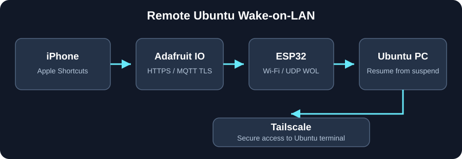
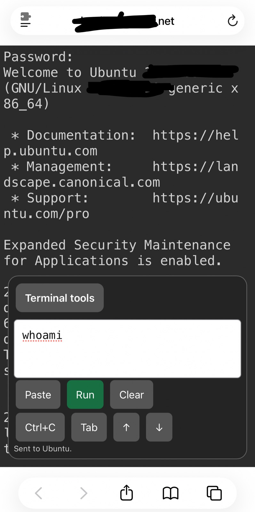

# ESP32 Ubuntu Remote Wake-on-LAN

Wake an Ubuntu desktop from **suspend** using an iPhone over mobile data, with an independently powered ESP32.

**Architecture:** iPhone Apple Shortcuts → Adafruit IO HTTPS → MQTT over TLS → ESP32 → LAN UDP Wake-on-LAN → Ubuntu resumes from suspend → Tailscale-hosted terminal.

The ESP32 also offers a local web button at `http://<ESP32_IP>/` for use on home Wi-Fi.

## Architecture

## Requirements

- Standard ESP32 development board (tested with an original ESP32 and 4 MB flash)
- An **independent** USB power supply for ESP32; the suspended PC may shut off USB power
- Ubuntu desktop with Ethernet Wake-on-LAN and compatible suspend configuration
- Arduino IDE: Espressif `esp32` board package and `PubSubClient` (Nick O'Leary)
- Adafruit IO account with a private feed named `ubuntu-wake`
- Tailscale on iPhone and Ubuntu for the terminal connection **after** the PC resumes

## Configure and upload

Open `ESP32_WOL_Remote/ESP32_WOL_Remote.ino`. Replace the configuration values:

- `YOUR_WIFI_SSID`, `YOUR_WIFI_PASSWORD`
- `YOUR_ADAFRUIT_USERNAME`, `YOUR_ADAFRUIT_IO_KEY`
- `YOUR_ADAFRUIT_USERNAME/feeds/ubuntu-wake` MQTT topic
- `PC_MAC`: the Ethernet MAC of the Ubuntu desktop
- `broadcastIP`: the broadcast address of your local subnet

Upload using the correct ESP32 board and port. Serial Monitor runs at **115200 baud**.

Expected logs: `[WiFi] Ready at ...`, `[MQTT] Subscribed: ubuntu-wake`.

## Apple Shortcut

Create a **Get Contents of URL** action:

- URL: `https://io.adafruit.com/api/v2/YOUR_ADAFRUIT_USERNAME/feeds/ubuntu-wake/data`
- HTTP method: `POST`
- Header `X-AIO-Key`: your Adafruit IO API key
- JSON request body: `{"value":"WAKE"}`

Then use **Wait** followed by **Open URLs**, specifying *your own* Tailscale terminal URL. A readiness check is more reliable than a fixed wait.

## Verify

1. Use the local web button on home Wi-Fi.
2. Independently power the ESP32, suspend Ubuntu, and verify it resumes using the local button.
3. Publish uppercase `WAKE` through Adafruit IO; verify MQTT reception in Serial Monitor.
4. Run the Shortcut over **mobile data** and confirm Ubuntu resumes and the Tailscale terminal can be reached.

**Important:** Publishing to the feed confirms receipt at Adafruit IO, not necessarily delivery to the ESP32. MQTT logs confirm the ESP32 received the command.

## Security

Do not commit Wi-Fi passwords, Adafruit API keys, or private Tailscale details. The local HTTP wake endpoint has no authentication and must remain on a trusted LAN. The firmware uses a TLS CA certificate to validate the Adafruit MQTT connection.

## Inspiration

Inspired by the remote MQTT/Wake-on-LAN architecture in [Jonathan0823/esp32-wake-on-lan-remote](https://github.com/Jonathan0823/esp32-wake-on-lan-remote). This is a simplified standalone Arduino sketch focused on Apple Shortcuts and Tailscale.
